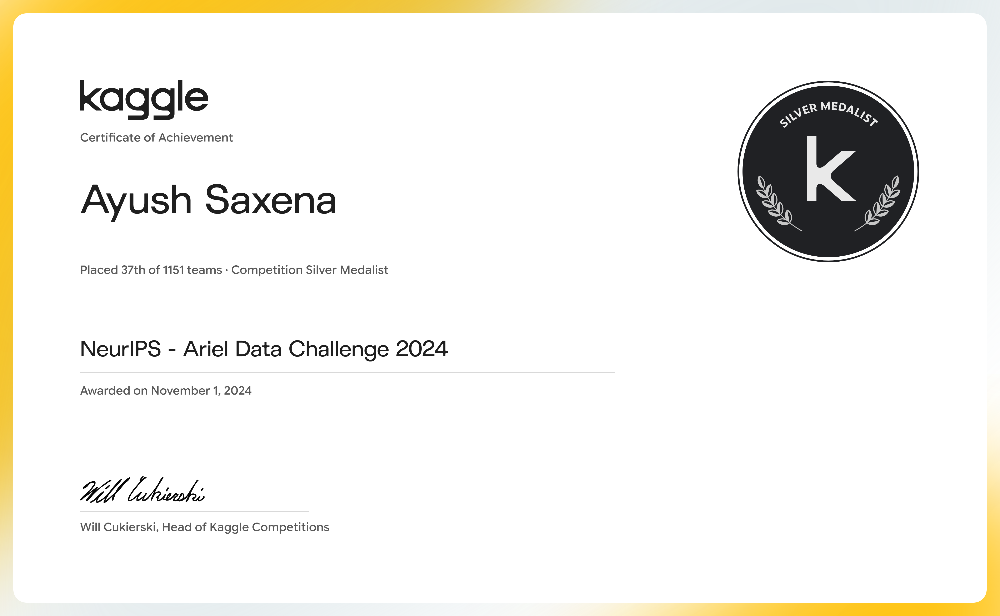

# NeurIPS – Ariel Data Challenge 2024

Our team finished **37th out of 1,151 teams** and received a **Kaggle Competition Silver Medal**.

The challenge asked us to use data from the ESA Ariel mission to predict how much a star's light dims when a planet passes in front of it. This small drop in brightness is called a *transit depth*. Getting a good estimate means finding the planet's signal in measurements that also contain noise and other variations.

## Our result

We tested several versions of our solution. These were our two strongest reported versions:

| Version | Public score | Private score | Public leaderboard place | Final place |
|---|---:|---:|---:|---:|
| 10 | 0.6152848 | 0.6198108 | 53 | — |
| 11 | 0.6128403 | **0.6293136** | — | **37** |

The final ranking was based on the private leaderboard. Version 11 is the solution that finished in 37th place.

## What we built

We built a data-processing and prediction pipeline using **AIRS data**. In simple terms, we cleaned and prepared the measurements, identified the part of the signal where a planet crosses its star, measured useful patterns in that signal, and used many models together to estimate the transit depth.

Our Version 11 approach followed these steps:

1. Correct and normalize the signal.
2. Smooth noisy measurements using a Gaussian filter.
3. Find the start and end of the transit, taking limb darkening into account.
4. Extract features from the full signal.
5. Extract more features by grouping nearby wavelengths in groups of **6, 10, and 25**.
6. Train an ensemble of **1,000 models**: 500 Ridge regression models and 500 PLSRegression models.
7. Combine the predictions. For each wavelength, we removed the lowest and highest 30% of predictions and averaged the rest.
8. Estimate uncertainty from the spread of the model predictions, using a scale factor of 4.

We also built the pipeline as smaller configurable steps. This made it easier to try different filtering, detrending, and feature-extraction settings without rebuilding the whole process each time.

## What we learned

We tried other approaches too, including wavelet filtering, median filtering, Savitzky–Golay filtering, Gaussian processes, tree-based models, and a neural network. They did not improve the final submission enough to replace our chosen approach within the time available.

With more time, we would have liked to test FGS data, create additional training examples with the BATMAN transit model, improve feature selection, and explore uncertainty estimation further.

## My contribution

### Transit detection
- Wrote the logic to identify where the planet starts and stops crossing the star.
- Accounted for limb darkening so the transit dip shape was handled properly.
- Tuned the detection settings.

### Feature engineering
- Extracted features from the full signal.
- Built multiscale features by grouping nearby wavelengths in sets of 6, 10, and 25. Notebook 02 focuses mainly on this work.
- Experimented with feature selection.

## Notebooks

The two notebooks shared here show selected versions of our work:

- [01 — Transit-depth ensemble baseline](01-ariel-transit-depth-ensemble-baseline.ipynb)
- [02 — Multiscale spectral-feature ensemble](02-ariel-multiscale-spectral-feature-ensemble.ipynb)

The second notebook contains the expanded feature approach. The reported 37th-place result is from Version 11, as described in the original solution write-up.

The notebooks use the original competition data and model files. Those external files and paths need to be set up before the notebooks can be run.

## Team

This was a team effort. Thanks to the competition organizers, our teammates, and all the other competitors who made the challenge worthwhile.

- [Shamil Yagiyayev](https://github.com/shamily)
- [Octavi Grau](https://github.com/octavigrau)
- [Ayush Saxena](https://github.com/ayuchsaxena)

**Citation**

Shamil Yagiyayev, Octavi Grau, and Ayush Saxena. *37th Place Solution — NeurIPS Ariel Data Challenge 2024*. Kaggle, 2024.
